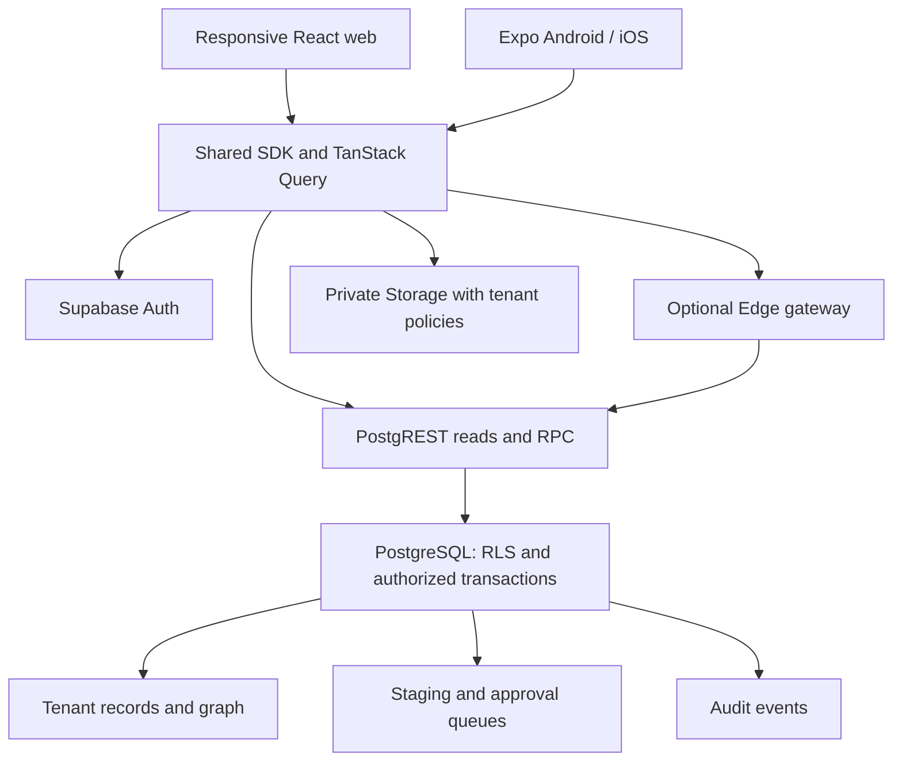
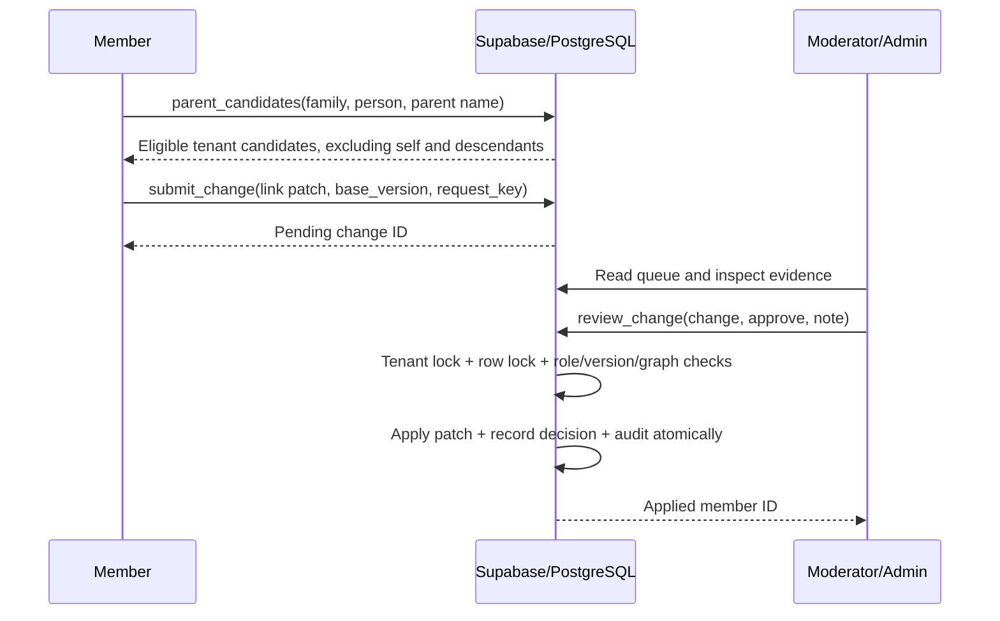

# Dynamic Centralized Family Tree Platform — specification

Version: 1.0. Reference date: 2026-11-05. Scope: responsive web and native Android/iOS clients, shared Supabase backend, private family trees, invitations, approved profile edits, bulk import, and interactive genealogy.

## 1. Architecture and decisions

Use React + Vite + Tailwind for web, Expo React Native for mobile, Supabase Auth for identity, PostgreSQL for authoritative state, private Supabase Storage for images, and TanStack Query for server state. Supabase Edge Functions are thin optional integrations; they must carry the user's JWT through to PostgreSQL. No separate application server or always-running worker is required.



Three possible tenancy models were considered:

| Model | Trade-off |
|---|---|
| Shared tables with `family_id` — selected | Fits a single free Supabase project, one migration history, immediate cross-tenant audit support; requires strict policies and composite foreign keys. |
| Schema per family | More isolation in naming, but migrations, API exposure, and schema administration grow with tenants. |
| Supabase project per family | Strong operational separation, but incompatible with a centralized free-tier architecture at meaningful tenant counts. |

Use database membership lookup rather than tenant role claims as the source of truth. Roles embedded in JWTs can be stale until token refresh. Claims may provide UI hints, but cannot grant privileges. Never trust `user_metadata`, a client-supplied role, or a client-supplied user ID for authorization.

The supplied migrations target a **fresh Supabase database**. The first migration revokes grants across `public`; do not apply it unchanged to a project containing unrelated APIs. Review and scope grants when integrating with an existing project.

## 2. Domain model and lineage flexibility

`families.id` is the tenant identifier. Every tenant-owned row carries `family_id`. Genealogy people exist in `members` whether alive, deceased, registered, or invited. Their optional `linked_user_id` connects a verified person to an Auth account; registration or matching an email must never create that connection automatically.

A non-null `families.admin_user_id` represents the single Admin. A deferred composite FK requires the Admin also to be a tenant member. `user_roles` stores only `member` or `moderator`; the effective `admin` role is derived from family ownership. This avoids two conflicting copies of Admin authority. `created_by` and `admin_user_id` are individually unique: one created tree and at most one currently administered tree per account. An account can belong to other families as a Member or Moderator. Admin transfer is atomic and immediately removes the old Admin's authority. The old Admin's creator entitlement remains consumed.

Super Admins reside in an unexposed `private.super_admins` table, provisioned by a trusted migration/database operator. They can read tenant configuration and audit metadata and suspend tenants or restrict feature flags. This role does not automatically grant access to every family's contact details or edit their genealogy. Account recovery or forced ownership transfer is a separately audited operator procedure.

The canonical ancestry graph has `father_id` and `mother_id`, both nullable and both composite foreign keys to `(family_id,id)`. Parent references never cross tenants. Unknown parents are null; do not invent a person called "Unknown". Parent roles imply neither a person's gender nor their caste. No constraint derives descent from surname, caste, gender, marital status, or birth place.

A family is a directed acyclic graph, not necessarily a strict tree: several people can share an ancestor. Render one node per person, preserving multiple edges. Do not make DOB mandatory or enforce an arbitrary parental age difference. Historical records need uncertainty notes rather than invented dates.

Caste, gotra, clan, branch, original locality, alternate names, and lineage terminology are optional metadata, never hardcoded tables per community. `families.settings` can contain:

```json
{
  "lineage_label": "Family",
  "default_view": "both_parents",
  "labels": { "father": "Father", "mother": "Mother", "ancestor": "Ancestor" },
  "field_definitions": [
    { "key": "gotra", "label": "Gotra", "type": "text", "visibility": "lineage", "required": false },
    { "key": "branch", "label": "Branch", "type": "enum", "options": ["East", "West"], "visibility": "lineage" }
  ]
}
```

`members.custom_fields` holds reviewed metadata visible to all members of that family. Unmapped CSV columns go to `member_private.extra_fields` by default. The supplied SQL validates object structure, size, key allowlists for core fields, and social link structure; a complete schema-driven form renderer and per-definition type/enum validation are an implementation milestone, not included UI functionality. Such validation must run in PostgreSQL as well as the client before promoting arbitrary custom fields. Admins must not place contact or sensitive data in lineage-visible fields.

The two canonical parent slots satisfy the requested hierarchy for any community without hardcoded caste assumptions. If multiple adoptive/biological parent sets, guardians, spouses, or additional relationship roles are required, add a tenant-scoped `relationships` table and reviewed relationship changes. Those are separate relationships and must not be encoded by overwriting canonical parent slots. A patrilineal or matrilineal display is a view filter, not deletion of the other parent edge.

## 3. Roles and authorization matrix

| Operation | Super Admin | Family Admin | Moderator | Member |
|---|---|---|---|---|
| Read own tenant genealogy | Only with membership | Yes | Yes | Yes |
| Read contact/DOB profiles | Only with membership rules | Tenant-wide | Tenant-wide for verification | Own claimed node |
| Submit edits or node claims | With membership | Yes | Yes | Yes |
| Approve submitted changes | No global bypass | Yes | Yes, excluding own submissions | No |
| Stage/approve CSV imports | No global bypass | Yes | No | No |
| Invite accounts; promote/demote Moderators | No global bypass | Yes | No | No |
| Transfer main Admin | Operator recovery separately | Yes, to existing tenant member | No | No |
| Change tenant name/settings/enabled features | Global restrictions only | Yes within global restrictions | No | No |
| Suspend tenant / restrict allowed features | Yes | No | No | No |
| Read immutable audit metadata | Across tenants | Own tenant | No | No |
| Upload/delete approved family images | Membership rules | Yes | Yes | No in this baseline |

Features are enabled only when both `allowed_features[key]` and `enabled_features[key]` are true. Admin preferences cannot override the Super Admin's restriction. Imports, suggestions/claims, and photo access enforce flags in database functions or Storage policies. Suspension blocks family operations and reads; global administrators can still inspect configuration and audit events.

All application tables have RLS enabled. `anon` gets no tree access. Authenticated clients receive SELECT grants governed by RLS. They receive **no direct INSERT/UPDATE/DELETE grants** on authoritative tables, membership, pending decisions, or audits. Even a Family Admin must use the authorized RPCs.

Privileged RPCs use `SECURITY DEFINER`, an empty search path, explicit schema names, explicit `auth.uid()` checks, tenant checks, and restricted EXECUTE grants. Their function owner can bypass RLS; therefore **RLS alone does not authorize a definer function**. The grants, function checks, composite FKs, locks, version checks, and RLS form the complete boundary. Private mutation helpers are not executable by authenticated clients. Do not put `private` in exposed PostgREST schemas.

## 4. Tables and constraints

| Table | Purpose and key constraints |
|---|---|
| `families` | Unique creator, unique non-null Admin, tenant settings, two-layer flags, suspension. |
| `user_roles` | `(family_id,user_id)` primary key; Auth membership, Member/Moderator role. |
| `members` | UUID identity; primary parents; tenant-local linked Auth account; version; lineage JSON. Duplicate names allowed. |
| `member_private` | DOB, current/street/original addresses, phone, email, social URLs, map URL, private extra columns. |
| `pending_changes` | Immutable submitted patch, expected version, kind, submitter, idempotency key, reviewer, status and result member ID. |
| `import_batches` | Staged normalized rows, tenant-local request key, decision and result mapping. |
| `import_issues` | Missing/ambiguous parent names, candidate IDs, affected node, parent role, resolution time. |
| `invitations` | Hashed single-use random token, normalized email, expiration and acceptance. Never readable by client SELECT. |
| `audit_events` | Append-only actor/action/tenant/entity metadata; contact values intentionally omitted. |
| `private.super_admins` | Trusted global operator membership; no self-service assignment. |

Indexes cover membership lookup, family+normalized-name, both family+parent columns, pending review queues and audit chronology. No uniqueness constraint on full name, email, phone, or DOB: those are not reliable human identifiers. The import's `Record ID` is an identifier only within that batch, not an Auth identity.

The `members` trigger locks the tenant and checks upward ancestry before accepting a parent assignment. Every exposed mutation acquires the same family row lock first, so two concurrent approvals cannot each create half of a cycle. Import writes and ownership changes use this same ordering. At default READ COMMITTED isolation, waiting transactions see the committed graph before checking it. Test concurrency against real PostgreSQL before release; clients do not select isolation levels.

## 5. CSV contract and linking

| Exact CSV header | Stored field |
|---|---|
| `Full Name` | `members.full_name` |
| `Address` | `member_private.address` |
| `Street Address` | `member_private.street_address` |
| `Original Address` | `member_private.original_address` |
| `Father's Name` | Parent-resolution hint; unresolved names preserved in import issues/batch |
| `Mother's Name` | Same resolver as father |
| `DOB` | `member_private.dob`, Gregorian `YYYY-MM-DD`, nullable |
| `Phone` | `member_private.phone`, string preserving `+` and leading zeros |
| `Email` | `member_private.email`, profile contact only |
| `Social Links` | JSON object, accepted case-insensitive keys normalized to `facebook`, `tiktok`, `instagram` |
| `Map URL` | Nullable HTTPS link; never fetched server-side |
| Additional columns | Private `extra_fields`; explicitly reviewed promotion to public lineage metadata |
| Optional `Record ID`, `Father Record ID`, `Mother Record ID` | Stable row references within this import |

PapaParse uses `dynamicTyping:false`, trims headers, preserves Unicode, strips BOM, and rejects duplicate headers and malformed CSV. Names preserve original spelling; matching uses PostgreSQL `lower(trim(name))`. No transliteration or fuzzy merge is performed. Interior whitespace and script variants may require manual reconciliation. Do not silently convert Bikram Sambat dates to Gregorian; request an explicit conversion with original date provenance.

Import sequence:

1. Admin selects a CSV, parses at most 200 rows / 1 MiB, previews normalized records and unknown columns, and confirms staging. Persist one UUID request key for retries.
2. `stage_import` revalidates server-side and stores rows only in the batch. Main members remain unchanged.
3. Admin reviews source provenance, existing-tree duplicates and consent, then explicitly calls `review_import(batch,true)`.
4. The approval transaction creates all person IDs first, regardless of input order.
5. For each parent, an explicit Record ID resolves exactly within the batch. A nonexistent explicit ID fails the whole approval.
6. Without an explicit ID, find exact normalized name matches across the family, including newly inserted people. One match becomes a link under the Admin's bulk approval. Zero or multiple matches become unresolved issues, with no parent link.
7. Graph and tenant constraints validate every relationship. A cycle, invalid profile value or missing explicit reference rolls back the **whole batch**, including generated people and audit events.
8. Store the resulting row-ID-to-UUID mapping and unresolved count. Repeating approval returns the saved result without inserting duplicates.

This is a **create-only import**. Reimporting a file under a different request key can create duplicate people. The preview must make this clear and require existing-data review. Do not deduplicate people by name or email. For updates, use the reviewed edit flow; a later upsert extension needs a tenant-scoped external source ID and explicit conflict semantics. Parents in another batch can resolve by unique name or a later approved link; do not assume `Record ID` persists across batches.

Exact names are candidates, not proof of parentage. This blueprint applies unique name links only during the Admin's explicit approval of the import. Interactive additions and Member choices always go through their own pending review. For ambiguous names, the UI lists candidate node IDs and existing parent context; the full application should offer a node-detail drilldown for further disambiguation without disclosing contact data.

## 6. Suggestions, personal claims and approval lifecycle



Pending states are `pending → approved` or `pending → rejected`. They cannot be edited by clients. Corrections require a new proposal. Admins may approve their own submissions, which is necessary for small-tree bootstrapping; Moderators must obtain a different reviewer for their own changes.

`create` creates a person only on approval; `edit` modifies allowlisted profile or lineage fields; `link` modifies only parent slots; `claim` has an empty patch and asks to bind the submitting Auth account to an unclaimed person. Claim approval uses the original submitter ID, never a client-supplied target user. The unique family+linked-user constraint prevents one account from claiming several people in a tenant.

Every existing-person proposal includes `base_version`. A different edit or approved claim increments the version. Stale approvals fail without changing their pending status. Refresh the record and submit a new proposal; do not silently rebase parent choices. Reviewers see before/after values and evidence in the full application; the reference supplies picker and service components rather than the whole review dashboard.

After approval, invalidate `['tree',familyId]`, `['member',familyId]`, `['pending',familyId]`, `['parent-candidates',familyId]`, and `['issues',familyId]`. Basic refetch-on-focus is sufficient for a free-tier baseline. Optional Realtime can invalidate these keys, but is not a permission boundary and consumes quota. Pending-submit success must never optimistically change canonical ancestry.

Normal users can propose changes to tenant people; they cannot read other people's private profiles. A claim does not itself grant a role or reveal private details until reviewed. Moderation must verify identity with agreed family evidence, not merely a matching email/name. There is no automatic account creation from imported Phone or Email.

## 7. API contract

Use the SQL migration as the authoritative signature definition. JS examples live in `blueprint/shared/api.ts`.

| RPC | Authorization / outcome |
|---|---|
| `create_family(name)` | Authenticated; one-created-tree uniqueness; inserts membership and audit atomically. |
| `create_invitation(family,email)` | Admin; returns a token once; digest only stored; 7-day expiry. |
| `accept_invitation(token)` | Signed-in account with matching confirmed email; single use; grants Member membership. |
| `set_role(family,user,role)` | Admin; existing tenant member only; Member/Moderator. |
| `transfer_admin(family,user)` | Current Admin; existing tenant member; exactly one Admin preserved. |
| `configure_family(...)` | Admin; settings and local feature preferences. |
| `configure_tenant(...)` | Super Admin; suspension and global allowed features. |
| `parent_candidates(...)` | Tenant membership and suggestions enabled; 25 exact matches maximum. |
| `submit_change(...)` | Tenant Member or above; creates pending proposal. |
| `review_change(...)` | Reviewer; locks, expected version, idempotent decision, authoritative apply. |
| `stage_import(...)` / `review_import(...)` | Admin, imports enabled; staging separate from final approval. |
| `ancestor_window(...)` | Tenant read; depth 0–8; each person once with maximum encountered ancestor distance. |
| `descendant_window(...)` | Tenant read; depth 0–8, at most 500 people; breadth-first distance. |

The parent candidate RPC caps results at 25. For larger ambiguity sets, the completed UI must offer a tenant-scoped paginated search and node lookup rather than interpreting the cap as "no other candidates". The supplied picker handles zero/one/multiple choices and displays server errors; approve-time validation remains authoritative if a candidate becomes invalid after the suggestion query.

The optional Edge Function demonstrates an authenticated JSON HTTP facade with a bounded request body, explicit origin handling, user token validation, and the user's Supabase client context. CORS restricts browser integration; JWT checks and database rules provide authorization for all clients, including native apps.

## 8. UI and mobile behavior

Web routes: `/auth`, `/families`, `/family/:id/tree`, `/family/:id/members/:memberId`, `/family/:id/suggestions`, `/family/:id/review`, `/family/:id/import`, `/family/:id/settings`, and `/system/tenants`. Route guards improve UX; the database independently enforces permissions. The family switcher only lists memberships visible to the user.

A tree screen opens around a selected person with four ancestor generations. Edges run ancestor-to-descendant. Users can select another node to refocus, inspect details, choose a descendant view, and expand a branch. Roots are people with no known parent; disconnected roots and incomplete records are valid. Generation labels are relative to the current focus, not globally stored integers. A reused ancestor can occupy several genealogical generations; layout rank is a display choice, not a claim of a universal generation number.

Web uses React Flow and Dagre. Mobile uses native SVG and touch targets with the same pure-JS layout, because React Flow is DOM-based. The supplied native graph supports scrolling and tapping; pinch-to-zoom and large-graph virtualization are further UI work. Dagre offers practical initial layout, not specialized spouse alignment or publication-quality genealogy routing.

Provide accessible list navigation beside charts, screen-reader labels, visible focus, minimum 44–48px touch targets, loading/error/empty states and text scaling. No caste-specific default ranking. Profile forms should distinguish unknown data from deliberately withheld data. Keep exact addresses, phone, email and DOB off chart nodes.

Shared code: data types, RPC adapter, parsing, query hooks and graph layout. Platform code: Auth persistence and deep links, file picker, chart rendering and navigation. Use query keys containing family ID and focus ID. On sign-out or account switch, clear the QueryClient, detach subscriptions, discard staged forms and invalidate short-lived image URLs. Do not persist genealogy query caches to public device storage. Use AsyncStorage for baseline Auth session persistence per the official quickstart; assess platform secure credential storage and device threat models before a public launch.

## 9. Storage, privacy and operations

`family-media` is a private bucket. Object keys start `familyUUID/memberUUID/`; policies verify the actual tenant/person pair. Only reviewers can upload/delete, photos must be enabled, and MIME/size restrictions allow JPEG/PNG/WebP up to 512 KiB. Use immutable random filenames rather than upserts; issue short-lived signed URLs on demand. Signed URLs remain usable until expiry after revocation, so keep lifetimes short (for example 60 seconds). Do not store signed URLs in database records. Member-uploaded unapproved media needs a separate private staging bucket and review transaction; it is outside this baseline.

Never put service-role/secret keys in Vite variables, Expo variables, a browser bundle, or a mobile binary. Public project keys are expected to be distributed. They are safe only with correctly restricted grants and RLS. Avoid putting private data in logs, URLs, crash reports, or analytics. Parse links as URLs and render plain escaped text; no raw imported HTML. Exports should neutralize spreadsheet formula prefixes `=`, `+`, `-`, `@`, tab and carriage return while preserving the canonical stored strings.

Genealogy data can concern minors and unregistered people. Before public operation, define consent, record correction, access/export and deletion procedures. Collect the minimum needed. Audit metadata does not include raw contact fields, but historical pending patches and import payloads do; apply a documented retention period (recommended initial policy: 30 days after final review for raw payloads), retain minimal decisions and provenance, and account for backups. No automatic deletion worker is installed by this blueprint.

Do not hard-delete an Admin Auth account: restricted FKs intentionally prevent tenant orphaning. Transfer ownership first, then perform reviewed de-identification/deletion. Person deletion, role removal, tenant deletion and forced account recovery are operator workflows to implement with dependency checks and audit events; no unsafe cascading public delete API is supplied.

## 10. Implementation sequence and acceptance

1. Backend foundation: migrations, generated Supabase types, real JWT isolation tests, Auth providers, invite acceptance, Admin transfer and operator bootstrap.
2. Genealogy: profile forms, private detail screen, approved edits/claims, review dashboard, ancestor/descendant navigation and accessible list.
3. Import: file picker, validation and preview, staged batch review, provenance/duplicate warnings, issue queue and parent resolution.
4. Configuration: dynamic field registry enforcement/forms, per-family feature UI, Super Admin tenant console, reviewed media upload.
5. Release: telemetry without PII, quotas, payload retention, exports/deletion operations, backups and restore drill, web and APK deployment, mobile accessibility and device QA.

Acceptance means: strangers see no tree; membership in A grants no B access; no user can grant themselves a role; exactly one Admin exists even during transfer; two reviewers cannot apply one proposal twice; stale edits do not overwrite new data; ambiguous names remain unlinked; parent references stay in-tenant; no cycle is possible through either parent; rejecting a batch creates nobody; retried imports do not duplicate people; personal claims require approval; public Auth clients cannot mutate authoritative tables directly. Free-tier deployment must also remain within the measured budgets in the deployment guide.

The supplied reference files cover the core schema, transaction flows and requested rendering/conflict examples. Navigation, full Auth screens, moderation dashboards, registry enforcement, operational jobs and end-to-end app assembly remain implementation tasks. Production readiness depends on completing those tasks and the acceptance checks, not just applying the migrations.
